# Collier Gloves

<p align="center">
  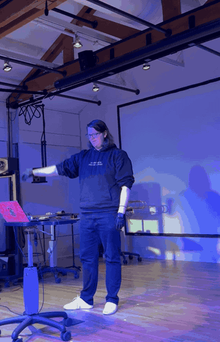
</p>

For my MUSIC 250A final project (Physical Interaction Design for Music, Stanford, spring 2026) I built two sensor gloves so I could conduct a choir the way Jacob Collier conducts his audiences. He points at a section of the crowd, they sing a note, and he moves them up and down from there. I wanted to do that with a choir that isn't there.

Each glove has a motion sensor on the back of the hand and ten bend sensors on the fingers, and sends all of it over Bluetooth to my laptop 100 times a second. A Python program turns pointing and a couple of hand gestures into notes for four choir sections, and a Max patch plays them through the Jacob Collier Audience Choir library in Kontakt.

**[Watch the demo (1:47)](media/2026-06-02-demo-highlight.mp4)** from the class showcase on June 2. A few things broke right before I went on (story below), so this is the "basic demo" version.

## How it went

### April: toys

I came into 250A and was "pretty quickly obsessed with all of the super cool glove interfaces" people had built (that's me at the showcase, explaining the project), so I figured I'd try to build my own. Before there was any glove I wrote a few small sketches to learn the parts: a proximity sensor driving MIDI on a Teensy, an I2C scanner to find the IMU, and the IMU plus one flex sensor printing to serial. They're in [`experiments/arduino-sketches/`](experiments/arduino-sketches/).

### May 5-6: a one-dollar brain

<p>
  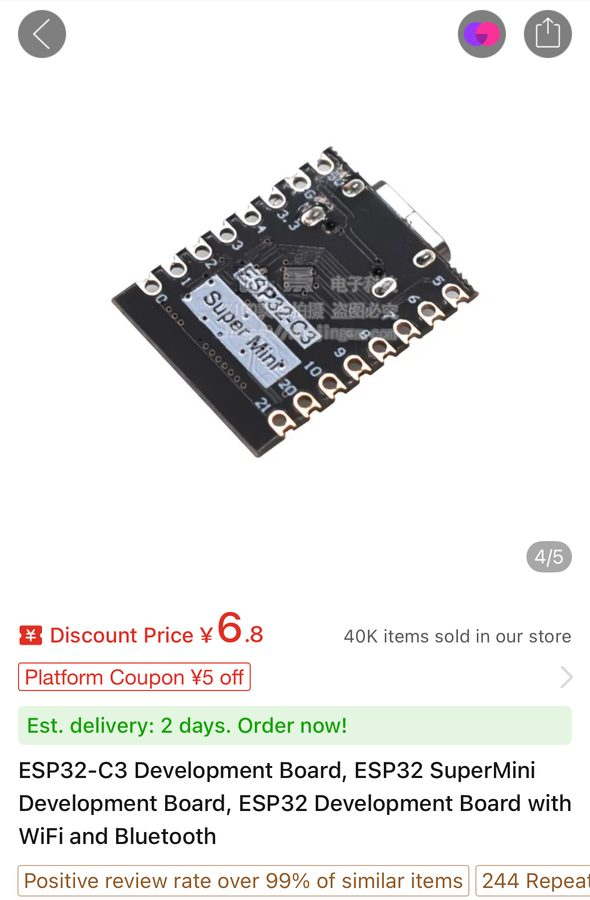
  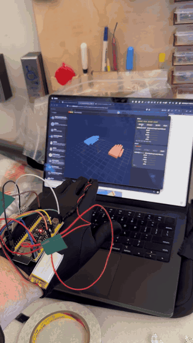
</p>

Each glove runs on an ESP32-C3 SuperMini, which costs about a dollar (that's the listing I screenshotted on May 5). The first wearable version, the next day, was a bigger dev board and a battery taped to a glove, streaming to a test page that drew both hands in 3D.

### May 9, midnight to 5 am: perfboard

<p>
  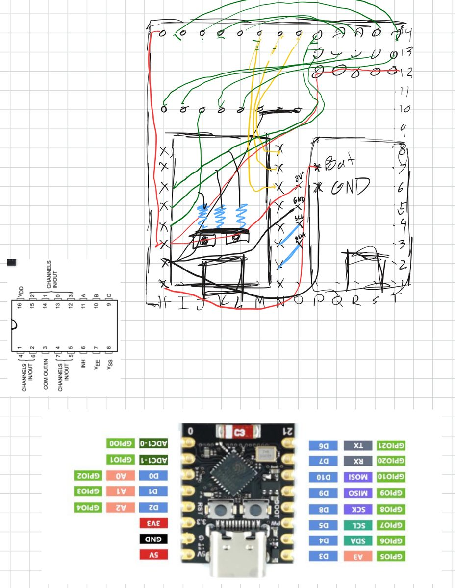
  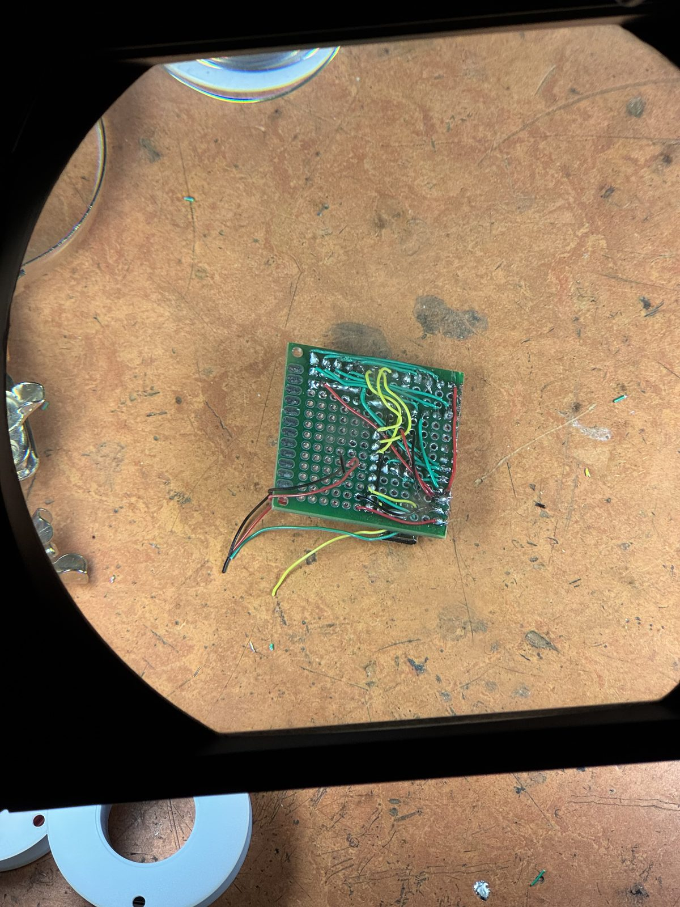
  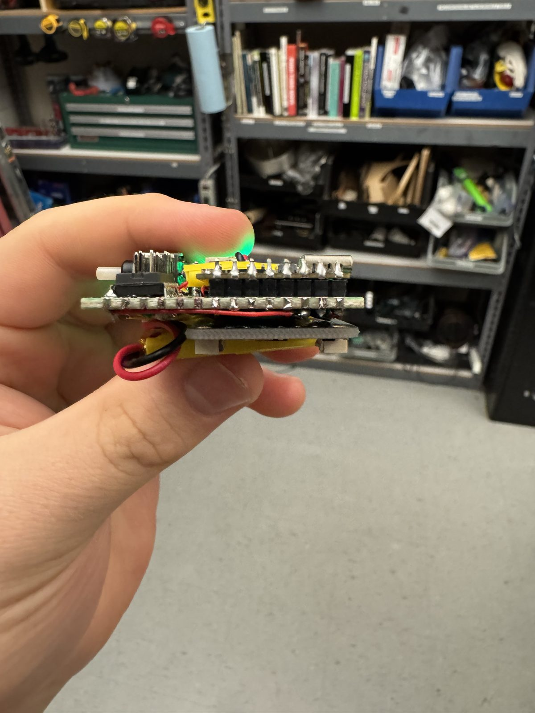
  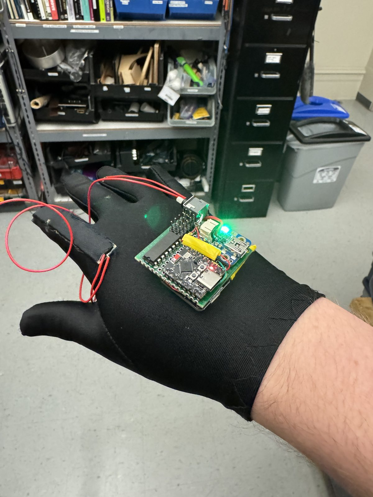
</p>

At midnight I drew out the board, with the pinouts pasted in next to it. By 3:27 am I was soldering under the magnifier, and by 4:56 the whole stack (ESP32-C3, BNO085 IMU, an 8-channel analog mux for the bend sensors, a LiPo and a power switch) was sitting on a glove.

### May 21: two gloves

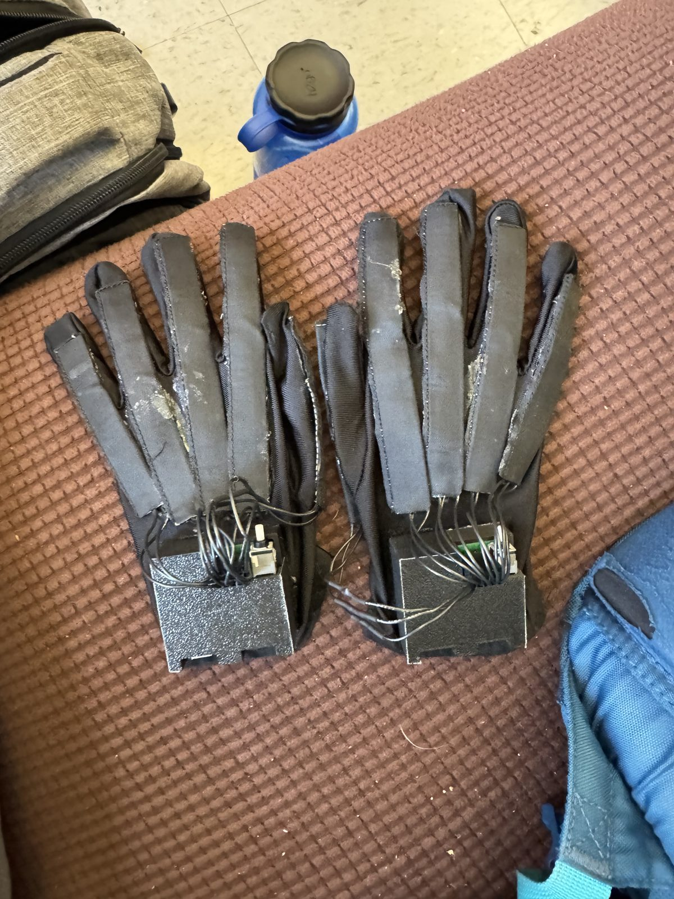

Two gloves, ten bend sensors each (two per finger), electronics in printed boxes on the wrists.

### May 24-27: everything except a choir

The git history starts May 24 at 10:34 pm. The first few days went to getting clean readings and trying instrument ideas. The bend pads bled into each other (bend one finger and its neighbors move too), so I trained small "demixers" to undo the crosstalk. I also tried a hand-pose decoder trained against webcam hand tracking, and built a chord synth, a cello, a singing instrument and a vocoder.

```
05-26 00:29  some iteration, still doesn't work well, onto a demixing approach
05-26 01:11  back to demixing, it works best.
05-26 16:14  sasha's idea
05-26 18:51  wow this one is cool
05-26 20:08  cello?
05-26 21:18  interesting vocoder
```

None of those instruments made it into the final version, and that code isn't in this repo, but I learned a lot about the sensors that week.

### May 28, 4:48 am: what does a conductor actually do?

<p>
  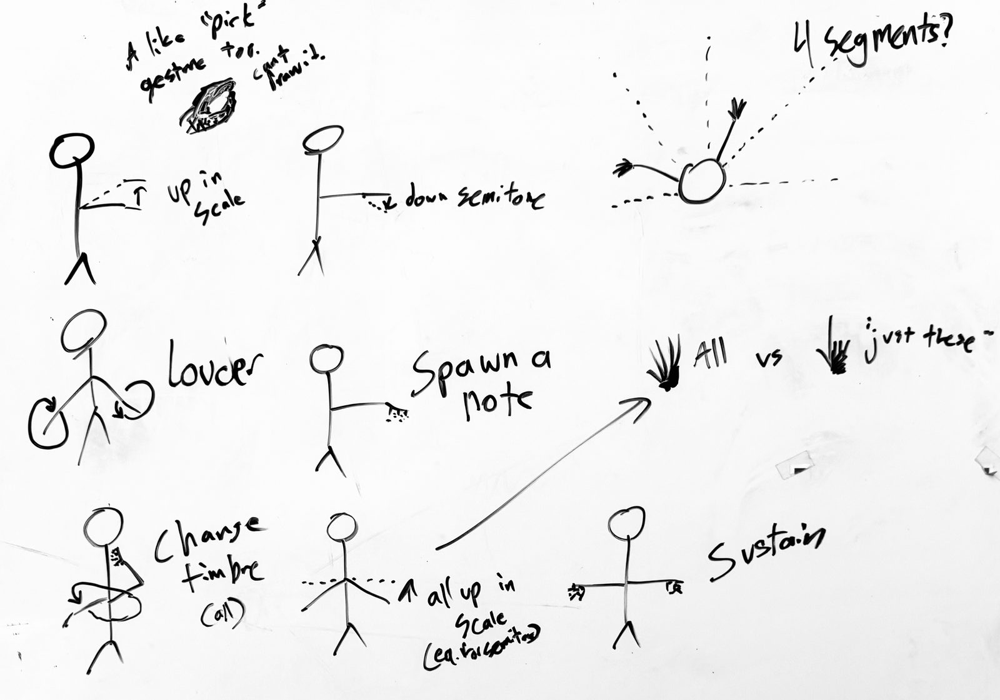
  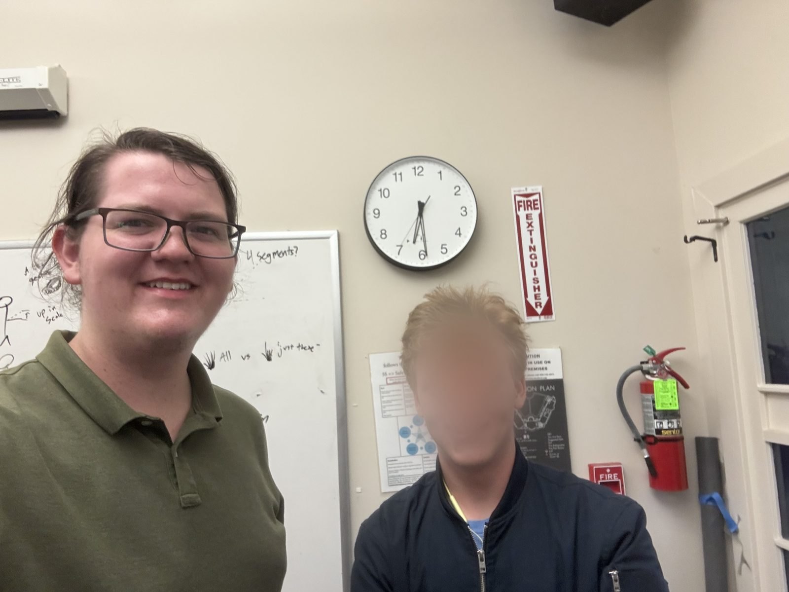
</p>

On this whiteboard the choir idea turned into a list of gestures: up in scale, down a semitone, louder, spawn a note, change timbre, "all vs just these", sustain, and a "4 segments?" that later became the four pointing regions. The top corner even has a "pick" gesture that counts how far the hand travels, which is pretty much how the final version ended up working. It took five more days and a machine learning detour to get back to it. An hour after this photo the first version of the conductor was in git. At 6:28 am my friend Malcolm and I took a picture with the clock, both still up working on our 250A finals.

### May 28-31: hand-written gestures, and why they misfired

The first conductor was a pile of hand-written detectors: point at a section, raise or lower your hand to step the pitch, tilt for semitones, flutter your fingers to start a note, palms up to address everyone. They misfired constantly. Raising your arm also rotates your wrist. A flutter shakes the IMU, so it looks like a tilt. A grab looks like a flutter. At times stage magnetic fields disturbed the magnetometer and fabric wearing out around the flex sensors caused lots of noisy readings, so this turned into a very difficult (but fun and eventually successful) signal processing project.

Firmware v3 (May 30) switched orientation to the IMU's game rotation vector, which doesn't use the magnetometer, to stop the two hands drifting apart. The old detectors are still in [`host/collier/gestures.py`](host/collier/gestures.py), under a header that calls them brittle.

```
05-30 23:38  I don't even know
05-31 02:45  holy shit we're getting somewhere
```

### May 31 to June 2: the machine learning all-nighter

<p>
  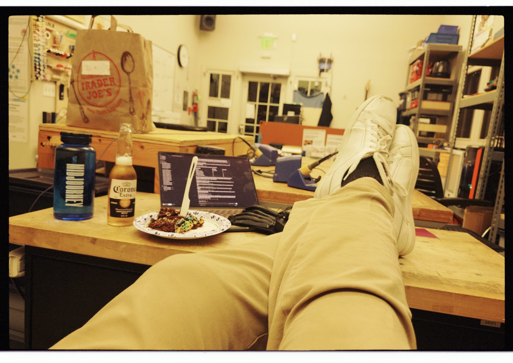
  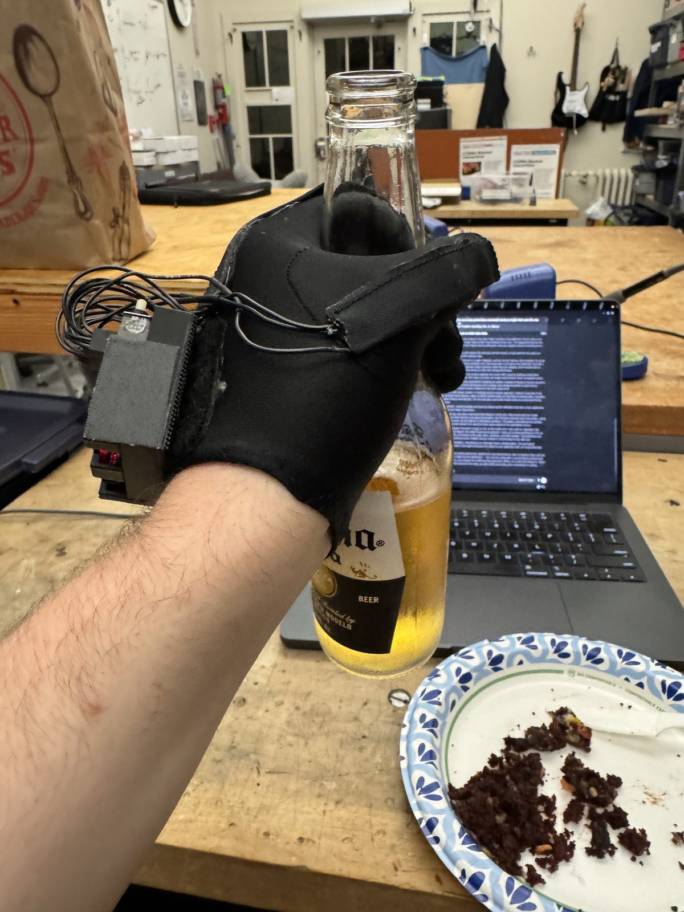
</p>

So I tried machine learning. I wrote a trainer app (record, label, train and live-test in one window), and on the afternoon of June 1 I recorded 510 labelled clips across 12 classes. Overnight I trained a small temporal convolutional network for each hand, and just after midnight it worked:

```
06-02 00:07  shit works, wow
```

There was a beer and some cake around 3 am. The model really did work well, right up until I took the gloves off and put them back on. Everything read slightly differently and the model fell apart. Digging into it that night, I found that no flex calibration was being saved anywhere, so the finger-bend ranges were relearned from scratch every session and drifted even while I was recording. The trainer, the diagnosis tools and my notes from that night are in [`experiments/ml-attempt/`](experiments/ml-attempt/).

### June 2, 5:22 am: back to heuristics

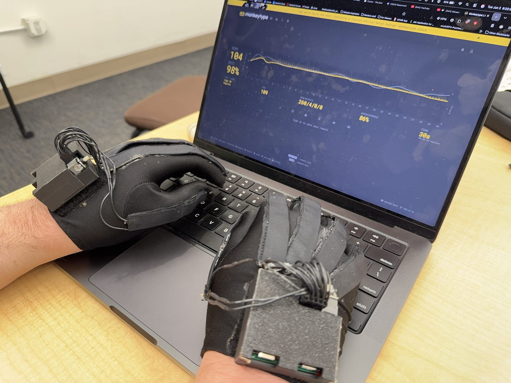

```
06-02 05:22  back to heuristics babyyyy
06-02 06:01  I cannot believe this works.
```

I cut the controls down to about two gestures and went back to simple rules, but this time the IMU decides what a gesture means and the bend sensors only answer one question: is the hand closed? Closing your hand latches a "pick". While a hand is picked, the IMU measures how far it moves up or down and how the palm is rolled when you let go. Three quick picks start a section singing (or mute it). The IMU gave a much more consistent signal than the bend sensors.

Twenty minutes after that commit I took a typing test with both gloves on. 104 wpm.

### June 2, 3 to 7 pm: making it a performance

A timbre gesture, four 60° pointing regions (one per choir section), a held "chest pose" that streams finger bends to the effects, and sound design in Max. The last commit before the showcase is `time to present`, at 7:01 pm.

### June 2, 8:08 pm: the showcase

<p>
  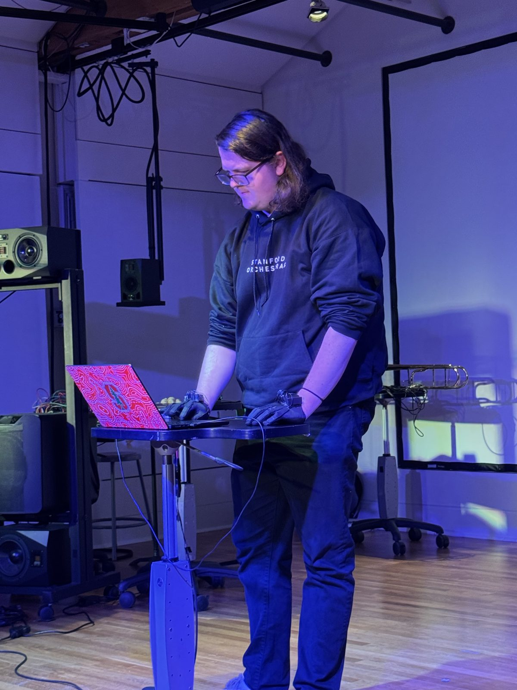
  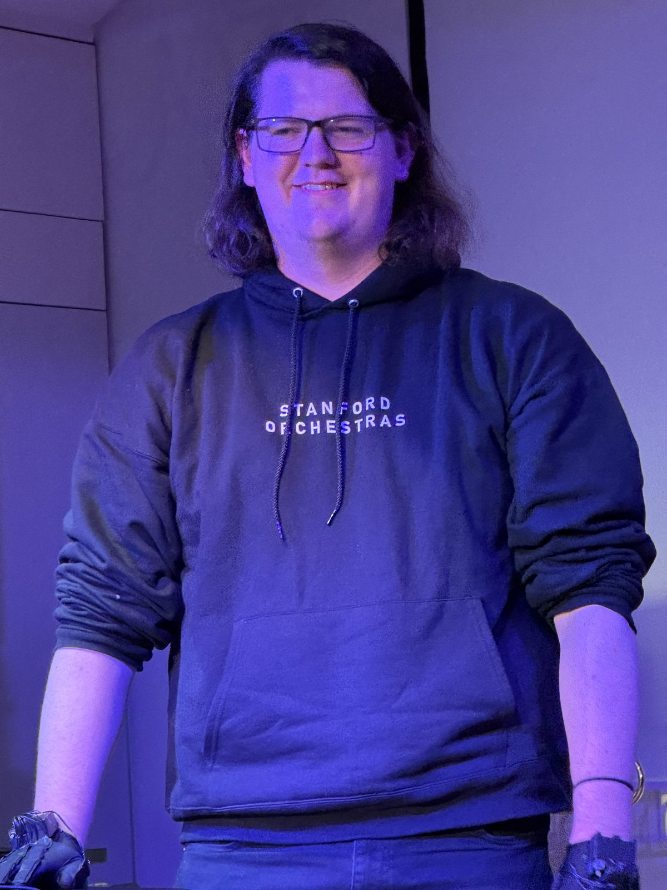
</p>

I calibrated my forward heading, played a single note, and nothing came out. My Max patch wasn't enabled. Then the audio was going to my Bluetooth headphones, and "one of the downsides of doing things with Bluetooth" is that turning Bluetooth off to fix that also disconnects both gloves, so I had to calibrate again. Then the effects part of the Max patch stopped working, "which is strange because I didn't change anything." Someone suggested deleting it and hitting undo, but I'd just restarted my computer.

So I did the basic demo, notes only. That's the [video at the top](media/2026-06-02-demo-highlight.mp4). We recorded a proper take afterwards, and I don't have a copy of it yet.

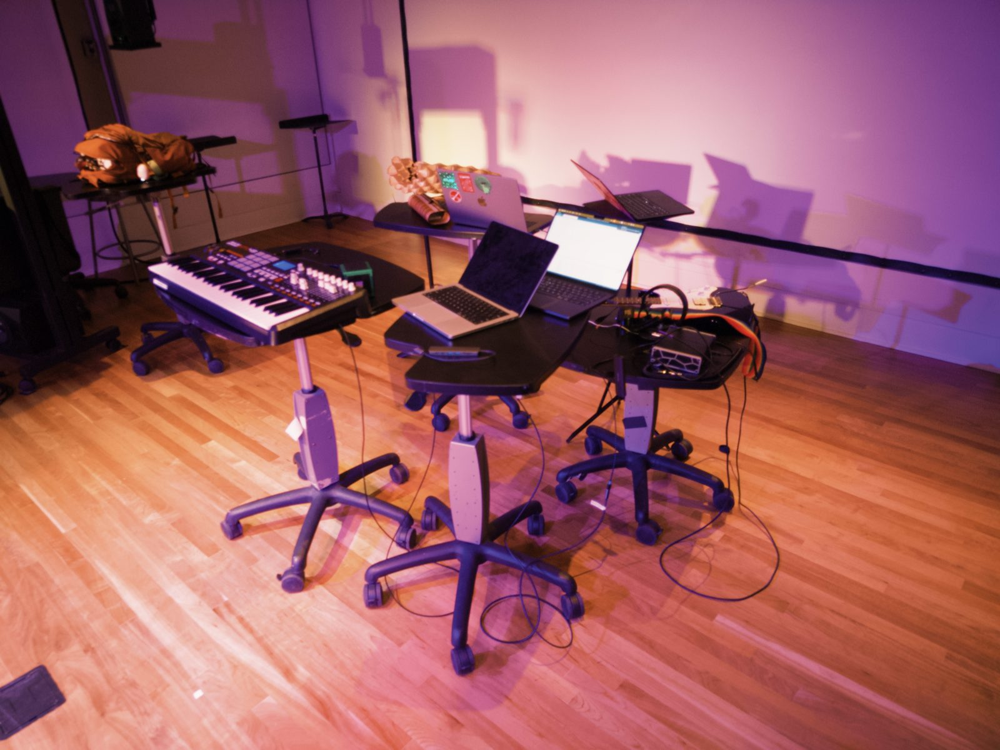

The gloves have been in a box since.

## When it happened

<picture>
  <source media="(prefers-color-scheme: dark)" srcset="media/commit-clock-dark.png">
  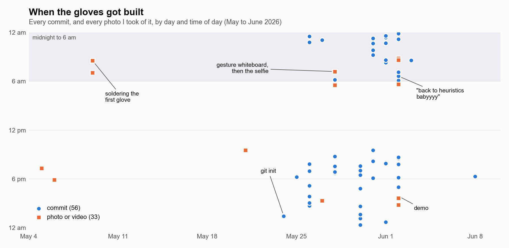
</picture>

Every commit and every photo, by day and time of day. 19 of the 56 commits landed between midnight and 6 am, which explains a lot about the code.

## How it works

```
glove x2: ESP32-C3 + BNO085 IMU + 10 bend sensors
   |   Bluetooth LE, one 86-byte packet every 10 ms
   v
host/collier/transport.py            finds both gloves by name, reconnects, decodes
   v
60 Hz tick (host/collier_live/conductor.py)
   |-- collier.conditioning          orientation, pointing heading, finger bends 0-1, open/closed
   '-- glove_ml_core.signals         vertical velocity and palm roll, in the hand's frame
   v
calibration -> pointing region -> pick engine -> one note per region
   v
OSC over UDP (127.0.0.1:7400)
   v
Max patch (host/max/conductor.maxpat) -> MIDI ch 1-4 -> Kontakt 8 choir -> effects -> speakers
```

### Hardware (per glove)

- **ESP32-C3 SuperMini**, advertising over BLE (NimBLE) as `Glove-L` or `Glove-R`.
- **BNO085 IMU** on the back of the hand, on I2C. The firmware uses its magnetometer-free game rotation vector for orientation, plus linear acceleration (gravity removed) and the calibrated gyro. The board sits upside down, so the host applies a fixed 180° mount correction.
- **Ten bend sensor channels**, two per finger (proximal and distal pads), each in a voltage divider. Eight go through a **CD74HC4051** analog mux into one ADC pin and two use direct ADC pins.
- A small LiPo and a slide switch.

Pins, the packet layout and flashing steps are in [`firmware/README.md`](firmware/README.md).

### The pipeline

1. **Transport.** `bleak` finds both gloves by name, reconnects whenever a link drops, and decodes each packet. Bluetooth timing is all over the place, so everything downstream runs on a fixed 60 Hz tick and every filter sees a constant time step.
2. **Conditioning.** Each hand goes through two signal layers. The `collier` one gives orientation, a horizontal pointing heading, and a bend value per finger from 0 to 1. Each bend channel is normalized to the 1st to 99th percentile of its last 60 seconds, so the range relearns itself after the gloves come off and go back on. The `glove_ml_core` one gives IMU features in the hand's frame. The pick engine uses two of them: vertical velocity (integrated from gravity-free acceleration and zeroed whenever the hand is still) and palm roll.
3. **Calibration.** Point both arms straight forward, hands level and open, and hold still for about a second. Then close and open each hand three times within 6 seconds. Each hand stores its own forward heading, and gestures switch on 2 seconds later. Do the same thing any time to re-zero.
4. **Pointing.** Each hand's heading relative to forward picks one of four regions, 60° each, across ±120°. Region 3 is on my left and region 0 on my right. The two hands point independently.
5. **Gestures** ([`host/collier_live/pick_engine.py`](host/collier_live/pick_engine.py)). A hand is *picked* when any finger other than the thumb bends past 50% of its range while the wrist is steady, and stays picked until those fingers open.

   | Gesture | What it does |
   |---|---|
   | Point, pick, move the hand up or down (about 10 cm or more), open within 2.5 s | The pointed region moves one step up or down the C major scale |
   | Same, with the palm rolled at least 18° when you open | All four regions step together |
   | Three quick picks within 1 s (each 0.3 s or less, no vertical travel) | First time: the pointed region starts singing C4. After that: mute or unmute it |
   | Hold both hands in the chest pose for 0.75 s | The ten finger bends stream to Max until you leave the pose |

   Notes stay between G1 and G5 (MIDI 31 to 79). The chest pose is a range of pitch, roll and stillness per hand, taken from two recorded poses in [`samples/pose_profiles/`](samples/pose_profiles/).
6. **OSC out** ([`host/collier_live/sinks.py`](host/collier_live/sinks.py)). Notes and spawns go out only when they change; the filter values stream while the chest pose is held.

   | Address | Payload |
   |---|---|
   | `/region/<i>/notes` | one MIDI note while sounding, `[]` when muted |
   | `/region/<i>/spawn` | `1` sounding, `0` muted |
   | `/expr/filters` | 10 floats from 0 to 1: left thumb to pinky, then right thumb to pinky (about 30 Hz, chest pose only) |

7. **Max** ([`host/max/conductor.maxpat`](host/max/conductor.maxpat), Max 9). The patch receives OSC on port 7400 and sends each region's note as MIDI on its own channel (1 to 4) to Kontakt 8, hosted with `vst~`. The left index and middle bends become CC1 and CC2. The right index and middle bends crossfade effect layers over Kontakt's output: `overdrive~` distortion, `pong~` wavefolding, and a short modulated delay.
8. **The window** shows a 240° pointing arc with both hands over the four regions, a card per region with its note, calibration progress, per-hand signal readouts, finger bends, and the last event.

## What's in here

| Path | What it is |
|---|---|
| [`firmware/`](firmware/) | The glove sketch (ESP32-C3), pins, packet format, flashing |
| [`host/`](host/) | The live pipeline that ran at the showcase (`collier_live`, the `collier` signal layer, `glove_ml_core`, `ml`) and the Max patch |
| [`tools/`](tools/) | Packet monitor, bend-pad health check, pose recorder, a manual OSC tester, a Qt fix for conda |
| [`experiments/ml-attempt/`](experiments/ml-attempt/) | The machine learning approach I dropped, kept as history |
| [`experiments/arduino-sketches/`](experiments/arduino-sketches/) | The April and early May sensor toys |
| [`samples/`](samples/) | Two labelled gesture clips and two recorded poses |
| [`media/`](media/) | Photos, GIFs and the demo video |

## Running it

You need two gloves flashed with the v3 firmware, a computer with Bluetooth LE, Python 3.10 or newer (I ran it on 3.13 on macOS), Max 9, and Kontakt 8 with the Jacob Collier Audience Choir library.

1. **Flash both gloves** ([`firmware/README.md`](firmware/README.md)) and check them:

   ```bash
   pip install bleak
   python tools/packet_monitor.py
   ```

2. **Install the host:**

   ```bash
   python3 -m venv .venv && source .venv/bin/activate
   pip install -r requirements.txt      # or: pip install -e .
   ```

   With Anaconda, PyQt6 can pick up conda's Qt5 plugins and fail to start. `host/qt_env.py` works around this at startup, and `bash tools/setup-qt6-conda-env.sh` fixes it for good in that env.

3. **Open `host/max/conductor.maxpat`** in Max 9, load the choir into the Kontakt 8 plugin inside the patch so it listens on MIDI channels 1 to 4, and turn audio on. (The saved Kontakt state isn't in this copy, since it's a commercial instrument.)

4. **Start the conductor:**

   ```bash
   cd host
   python -m collier_live               # with the window
   python -m collier_live --headless    # terminal only
   ```

   Options: `--engine pick|ml` (default `pick`), `--regions N` (default 4), `--osc-host` / `--osc-port` (default `127.0.0.1:7400`), `--no-filter-pose-gate` (stream finger bends all the time), `--flex-window-s` (default 60), `--manifest PATH`, `--debug`.

5. **Calibrate** (both hands forward and still, then three closes and opens per hand) and play.

To test the Max side without gloves, `python tools/manual_osc_gui.py` sends the same OSC messages from sliders and buttons.

| Tool | What it does |
|---|---|
| `tools/packet_monitor.py` | Per-glove packet rate, missed packets, quaternion, acceleration, gyro and raw bend values |
| `tools/pad_health.py` | Live table of all 20 bend channels with range and noise, flagging dead, stuck, noisy or weak pads |
| `tools/record_filter_pose.py` | Records a held pose and prints the pitch, roll and gyro bands for the chest-pose gate |
| `tools/manual_osc_gui.py` | Drives the Max patch by hand: notes, spawns and filter values per region |
| `tools/setup-qt6-conda-env.sh` | One-time PyQt6 plugin fix for Anaconda environments |

## Honest notes

- The code is a mess. The last week was me panicking and trying anything that might work, and you can tell. I took the dead ends out for this repo, but the code that ran at the showcase is the way it was.
- The ML model from that night still loads at startup and shows its guesses in the window, even though in the default mode it never triggers anything. So you still need PyTorch and the model files to start it. `--engine ml` switches back to the model if you want to see it misfire.
- If I picked this back up: take the model out of the live path, save a bend calibration per glove instead of relearning it every session, merge the two signal layers into one, and write tests for the pick engine (it's plain Python and doesn't need the gloves).

## Credits

- Sasha, for the open/closed-hand calibration idea on May 26.
- The sound is the Jacob Collier Audience Choir library (Native Instruments, for Kontakt). It isn't included here.
- Built with bleak, python-osc, PyTorch, PyQt6, qasync and NumPy on the laptop, Adafruit's BNO08x library and NimBLE-Arduino on the gloves, and Max for the sound.
- Malcolm, for being awake at 6:30 am too.
