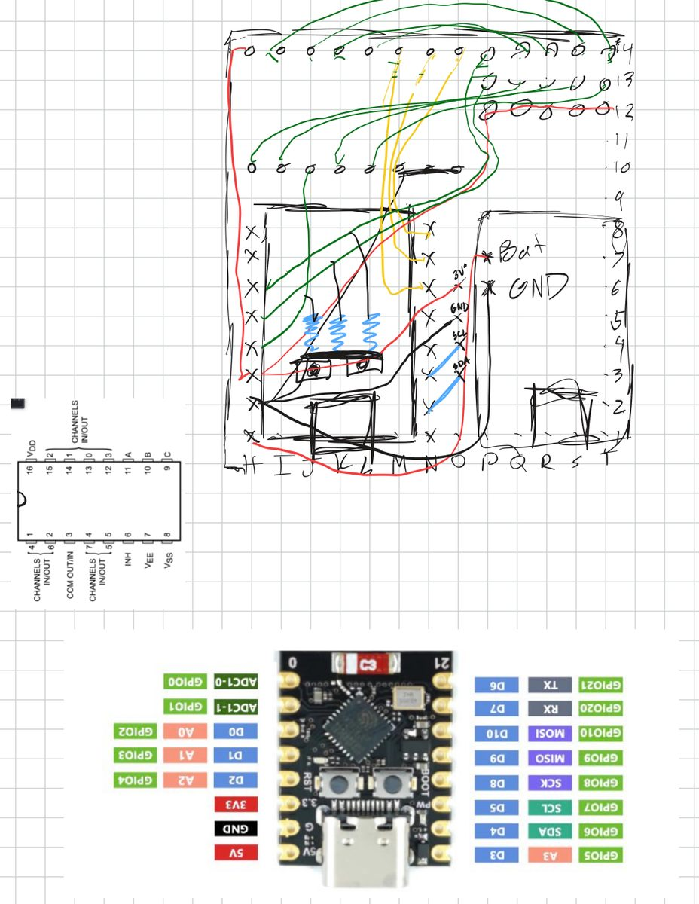

# Glove firmware (v3)

`glove_firmware_v3/glove_firmware_v3.ino` runs on each glove. It reads the IMU
and the ten flex channels and sends one 86-byte BLE notification every 10 ms.
The host (`host/collier/transport.py`) only accepts this 86-byte v3 packet.

Everything below comes from the sketch's own comments and `#define`s.

## Parts

- ESP32-C3 SuperMini
- BNO085 IMU on I2C, address `0x4A`, 400 kHz
- CD74HC4051 8-channel analog mux for eight flex channels
- Two more flex channels on direct ADC pins
- The flex sensors sit in voltage dividers.
- Each glove runs off a small LiPo pouch cell with a slide switch (you can see
  both in the photos in `../media/`).

## Pins

| Signal | ESP32-C3 pin |
|---|---|
| BNO085 SDA | GPIO6 (D4) |
| BNO085 SCL | GPIO7 (D5) |
| Mux COM / Z (analog out) | GPIO4 (A2 / D2) |
| Mux select A | GPIO10 (D10) |
| Mux select B | GPIO20 (D7) |
| Mux select C | GPIO21 (D6) |
| Mux INH, VEE, VSS | GND |
| Mux VDD | 3V3 |
| Flex channel 8 | GPIO2 (A0) |
| Flex channel 9 | GPIO3 (A1) |

Mux inputs Y0–Y7 are flex channels 0–7. The pin labels in parentheses come
from the v2 sketch's header; v3 says its wiring is identical to v2. Which
channel belongs to which finger differs between the two gloves. The maps are
`FINGER_CHANNELS_L` / `FINGER_CHANNELS_R` in `host/collier/config.py`, and
each finger has two channels (proximal and distal pads).

My hand-drawn perfboard plan from the night I soldered the first glove
(May 9, 2026), with the mux and SuperMini pinouts pasted in next to it:

## What it sends

The packet is little-endian, Python struct `"<BBH4f3f3f10H4ffBB"`, 86 bytes:

| Field | Type | Meaning |
|---|---|---|
| `glove_id` | uint8 | 0 = left, 1 = right |
| `seq` | uint8 | increments every packet |
| `timestamp_ms` | uint16 | `millis()` low 16 bits |
| `qw, qx, qy, qz` | 4 × float | game rotation vector (gyro + accel, no magnetometer) |
| `ax, ay, az` | 3 × float | linear acceleration, gravity removed (m/s²) |
| `gx, gy, gz` | 3 × float | calibrated gyro (rad/s) |
| `flex[10]` | 10 × uint16 | 12-bit ADC, 8× oversampled; `[0..7]` mux, `[8]` GPIO2, `[9]` GPIO3 |
| `sw, sx, sy, sz` | 4 × float | ARVR-stabilized rotation vector (uses the magnetometer) |
| `rv_accuracy` | float | heading-accuracy estimate of the stabilized vector (rad) |
| `rv_status` | uint8 | stabilized-vector fusion accuracy, 0–3 |
| `game_status` | uint8 | game-vector fusion accuracy, 0–3 |

The v3 sketch made the magnetometer-free game rotation vector the main
orientation source. Its header says this is because stage magnetic fields made
the two hands' headings drift apart. Slow gyro drift is corrected on the host
by re-pointing forward (calibration). The v3 fields come after the flex array,
so the v2 fields keep their offsets.

Rates: packets at 100 Hz; game vector, linear acceleration and gyro reports at
100 Hz; stabilized vector at 50 Hz.

BLE (NimBLE): device name `Glove-L` or `Glove-R`, service
`5a3e8f00-1c4e-4b8e-9b2c-7e1f8d9c3a1b`, notify characteristic
`5a3e8f01-1c4e-4b8e-9b2c-7e1f8d9c3a1b`, MTU 255, TX power P9.
The serial monitor (115200 baud) prints packet and IMU report rates plus raw
flex values once a second.

## Flashing

1. Arduino IDE with ESP32 board support. Libraries (Library Manager):
   **Adafruit BNO08x** and **NimBLE-Arduino ≥ 2.x** (h2zero).
2. Tools menu: Board "ESP32C3 Dev Module", USB CDC On Boot: Enabled,
   JTAG Adapter: Disabled, Flash Size: 4MB.
3. Left glove: `#define GLOVE_ID 0` and `#define GLOVE_NAME "Glove-L"`
   (the defaults). Right glove: `GLOVE_ID 1` and `"Glove-R"`. The host finds
   each glove by its BLE name, so the name decides the side.
4. Check both gloves with `python tools/packet_monitor.py`.

The older v2 sketch (64-byte packet, magnetometer-based rotation vector,
50 Hz) isn't included. The current host drops v2 packets.
